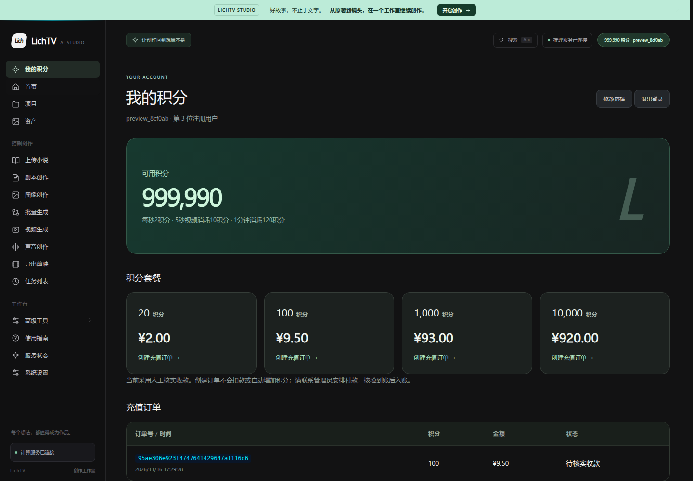
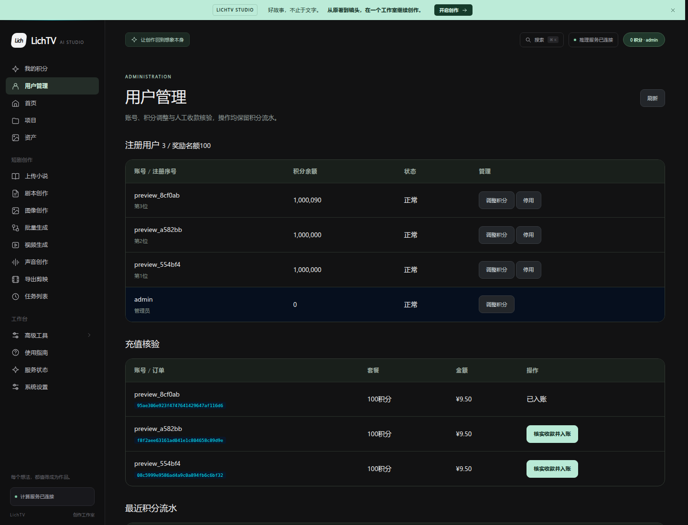

# LichTV 账号、积分与视频计费

在 LichTV 首页点击右上角“登录 / 注册”。首页可浏览，小说、剧本、生成任务、下载和积分账户需要登录。账号使用用户名和密码；未配置手机短信或邮箱验证。

## 注册奖励与套餐

前100个**成功注册的普通用户**，每人获得1,000,000积分。第101位起不赠送；系统初始化的管理员不占名额。重复注册失败不会消耗名额；停用账号不会释放已用名额。奖励在SQLite写事务中发放，按服务器注册序号判断。

| 套餐积分 | 人民币价格 |
|---:|---:|
| 20 | ¥2.00 |
| 100 | ¥9.50 |
| 1000 | ¥93.00 |
| 10000 | ¥920.00 |



“我的积分”展示余额、充值订单及最近100条积分流水。套餐金额由服务器以整数分保存，浏览器不能改价。

支付宝/微信扫码下单、支付通知和自动入账代码已经接入，真实商户资料未配置时渠道显示待配置。开通步骤见[支付宝与微信支付接入](lichtv_alipay_wechatpay.md)。

人工收款仍可使用：

1. 用户选择套餐，创建待核实订单；这一步不会扣款，也不会增加积分。
2. 用户联系管理员安排付款。页面没有虚构收款码或支付成功页。
3. 管理员进入“用户管理 → 充值核验”，确认实际到账金额与订单一致，填写真实收款流水号并确认。
4. 系统仅入账一次，同一个收款流水号不能给多个订单充值。

支付宝和微信自动收款需要完整商户配置及真实付款验收；尚未配置时不接受在线付款。未实现现金退款网关或发票服务。配置的HTTPS入口为 `https://drama.lianchengtech.cn/`，源站正常，外网访问仍需处理云平台拦截；账号与支付验收应使用HTTPS或加密SSH隧道。

## 视频扣费与排队

按**提交时选择的时长 × 2积分**预扣。例如5秒扣10积分，60秒合计扣120积分。视频编码器为对齐帧数生成的少量额外时长不另收费。单段支持1–15秒；一分钟可拆为4段15秒。批量按每一段分别入队和计费，最多20段；余额不足时不会撤回已经成功提交的前面任务。

- 成功出片：保留本次扣费，结果仅当前账号可访问。
- 已确认执行失败或无产出：自动退回该任务积分，每个任务只退一次。
- 排队未开始：用户可以取消并退款。
- 已开始：不调用全局中断，避免影响共用GPU的其他任务。
- 提交连接中断、响应丢失或提交过程中服务重启：状态变为“待管理员核对”，暂保留预扣。管理员核对GPU历史后登记实际prompt_id继续跟踪，或确认没有执行后退款；系统不会盲目再次提交。
- GPU隧道断开或暂时查询不到结果：继续保存运行中状态，不把网络故障误当成已终止任务。

当前一个服务进程维护一个持久化队列，对接现有单卡5090。SQLite写事务保护余额，并使用每个账号的幂等提交标识防止请求重试重复扣费。部署只启动一个Uvicorn进程；不要同时为同一数据库运行多个调度器。

## 受控工作流与界面

积分生成入口使用服务端工作流模板，浏览器不能上传或替换ComfyUI图结构、模型路径和计费时长节点。模型与量化仍沿用AutoDL镜像中的ComfyUI插件，并非改成FastVideo推理。

当前开放6个H3视频预设：U03文生视频加速版、U03文生视频基础版、U00、U06V9、U22和U30。后四种至少需要一张参考图；当前账号入口支持一张图片参考。未配置音频/视频参考上传及多参考编辑。分辨率采用已验证的480p级预设。

原14个图像预设接入账号队列；本次只定义了视频价格，图像生成不扣视频积分。图像页中已公开的画幅和百万像素字段可以覆盖；其他采样、LoRA和后处理参数固定为服务端预设。

“批量生成”和“任务列表”使用账号内的队列入口。旧高级工作流中尚未适配的直接生成、并发镜像、裸Comfy prompt、全局中断及实例管理接口不向本站用户开放；不能用它们绕过余额校验。原AutoDL上的工作流和数据文件没有删除，管理员仍可通过其SSH维护。原镜像的全部工作流并未自动获得账号计费支持。

小说、剧本、API分组、API图片和剪映下载包按账号存储。图像供应商API仍使用用户自己配置的密钥，供应商费用另外结算。新增的用户产出通过带会话校验的媒体地址读取，支持视频Range请求；不能猜另一个用户的任务号或路径下载文件。

## 管理员操作

管理员在左侧“用户管理”可以：

- 查看注册序号、余额和账号状态。
- 增减积分并填写原因；所有调整记录操作者和余额，不能扣成负数。在线订单只能由验签通知或向平台查单确认入账，不能人工标记已付。
- 停用或启用普通账号。停用立即撤销会话，并取消该用户未开始的任务、退回积分。
- 核验充值订单，查看积分流水。
- 处理提交状态不确定的GPU任务。



“我的积分 → 修改密码”需要当前密码，修改后撤销该账号所有已有会话。未实现自助找回密码；账号恢复由服务器管理员处理。

首次初始化管理员（**不要在网页注册管理员，也不要把凭据放在Web目录**）：

```bash
/data/lichtv-studio/venv/bin/python /data/lichtv-studio/app/studio_accounts.py \
  --data-dir /data/lichtv-studio/data \
  --username admin \
  --credential-file /data/lichtv-studio/admin-access.json
```

已有管理员时命令拒绝再次初始化。凭据文件仅管理员可读；领取后登录并修改密码。

## 存储与部署

- 服务：`lichtv-studio.service`，回环地址16128，以www-data运行。
- 程序：`studio_api.py`、`studio_accounts.py`。
- 积分与会话数据库：`/data/lichtv-studio/data/accounts.sqlite3`，使用WAL；禁止通过Web暴露。
- 私有模板：数据目录下 `workflow-catalog.json`；其中包含插件模板，不能作为静态资源发布或提交到公共仓库。
- 账号工作区：数据目录下 `users/<user_id>/`。
- 旧共享工作区文件保留，升级时复制给初始化管理员，不分发给新注册用户。

`build_account_catalog.py`从已验证计划生成私有模板；`configure_account_gateway.py`生成本站专用Nginx限制。公网 `/lichtv/` 与本地18008对应的内层服务器必须同时更新。只修改前端或只代理 `/studio-api/` 不足以执行积分校验。

备份数据库应使用SQLite backup API，保留数据库、账号工作区和私有模板的一致快照。运行中不要只复制主SQLite文件而遗漏WAL。回滚前端或API时不要覆盖已经产生的新余额和流水。

密码使用带随机盐的PBKDF2-HMAC-SHA256，600000次迭代；会话令牌以摘要存储，Cookie为HttpOnly和SameSite=Lax，HTTPS访问时设置Secure。写请求同时验证来源和会话CSRF令牌。生产公开注册尚无短信验证、实名校验或人机校验，注册送积分按账号计算，不保证一人只能注册一个账号。

## 回归验证

隔离CPU测试覆盖前100名并发注册、重复账号不占名额、余额原子扣减、幂等提交、单次退款、订单改价拒绝、重复收款流水回滚、越权拒绝、CSRF、退出登录、修改密码撤销会话，以及文档/导出隔离。

```bash
PYTEST_DISABLE_PLUGIN_AUTOLOAD=1 python -m pytest -c /dev/null \
  --confcutdir=examples/deployment/zealman_gateway \
  examples/deployment/zealman_gateway/test_studio_accounts.py \
  examples/deployment/zealman_gateway/test_studio_api.py -q
```

真实浏览器和GPU验收使用独立预览数据库，不占用正式站前100个奖励名额。

2026-11-16实际验收：18项CPU回归通过；桌面/手机浏览器验证注册、四档价格、人工充值核验、停用撤销会话、跨账号下载拒绝和公网子目录适配。使用独立数据库实际运行U03文生视频加速版，选择5秒，得到864×480、124帧、24fps、约5.167秒的视频，端到端约101秒，扣10积分；两次已确认失败的预扣均已退回。授权视频Range读取返回206，另一账号读取相同媒体ID返回404。

账号模块首发版本为 `bef696245ec3`；后续支付模块继续沿用账号与积分数据库。IP入口为 `http://124.174.14.4/lichtv/`；`https://drama.lianchengtech.cn/` 的源站HTTPS已配置，外部访问仍需处理云平台拦截。管理员初始化不占奖励名额，隔离预览账号未导入正式数据库。
