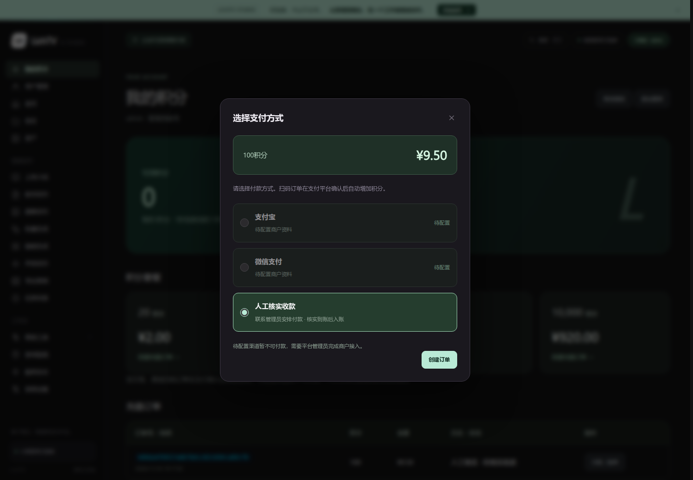

# LichTV 接入支付宝与微信支付

本模块把积分套餐接到支付宝当面付扫码支付和微信支付APIv3 Native支付。用户选择套餐、渠道并扫码付款，服务器验证交易后自动增加积分。未配置商户资料时，支付宝、微信显示“待配置”，不会生成付款二维码，也不会模拟支付成功。



## 当前交付与待完成事项

已实现签名下单、签名应答校验、付款二维码、订单状态查询、支付通知验签、微信通知AES-GCM解密、主动查单补单和积分幂等入账。原人工核实收款流程保留，旧订单仍是人工订单。

当前服务器尚未提供两家的真实商户参数和密钥，公网HTTPS回调也仍需解决外部访问拦截，因此**真实收款尚未启用，尚未完成真实付款验收**。本次测试使用本地RSA密钥签名、AES-GCM加密报文及浏览器桩，不向支付平台创建测试资金交易。

原有 `https://drama.lianchengtech.cn/` 源站证书验证及应用访问正常，本次将其旧Basic Auth改为本站账号登录；通知接口免会话登录，但必须通过平台验签。公网复查仍发现该域名TLS连接被关闭，主域名HTTP跳转至 `webblock.volcengine.com`；需要在火山引擎核实接入备案与拦截状态，确保支付平台能从云外访问回调。当前公开IP入口为 `http://124.174.14.4/lichtv/`，涉及账号登录或支付的验收应使用可访问的HTTPS或加密SSH隧道。域名外网恢复后应使用HTTPS入口；两个入口共用账号数据库，登录Cookie按域名分别保存。

在域名外部访问恢复前，需要登录检查界面时使用SSH隧道。将下面的私钥路径换成你的云服务器私钥，浏览器打开 `http://127.0.0.1:18008/`，密码经加密SSH传输：

```bash
ssh -i ~/.ssh/yeedy.pem -N -L 18008:127.0.0.1:16018 root@124.174.14.4
```

已有18008隧道时继续使用，不要重复绑定该端口。公网IP的HTTP入口不用于提交管理员凭据。

## 准备商户资料

支付宝使用 `alipay.trade.precreate`，微信使用 `/v3/pay/transactions/native`。需要商户实际获得对应产品权限，应用已创建不等于支付产品已开通。接口参数见[支付宝官方Easy SDK当面付文档](https://github.com/alipay/alipay-easysdk/blob/master/APIDoc.md#faceToFace)与[微信官方Native下单文档](https://pay.wechatpay.cn/doc/v3/merchant/4012791877)。

| 支付渠道 | 提供的资料 | 本实现对应字段 |
|---|---|---|
| 支付宝 | 应用AppID | `alipay.app_id` |
| 支付宝 | 实际收款卖家UID | `alipay.seller_id` |
| 支付宝 | 对应应用的RSA私钥文件 | `alipay.private_key_file` |
| 支付宝 | 支付宝RSA公钥文件 | `alipay.alipay_public_key_file` |
| 微信 | 已与商户号绑定的AppID | `wechatpay.app_id` |
| 微信 | 直连商户号 | `wechatpay.mch_id` |
| 微信 | 商户API证书序列号 | `wechatpay.merchant_serial` |
| 微信 | 对应该证书的商户API私钥文件 | `wechatpay.private_key_file` |
| 微信 | 32字节APIv3密钥文件 | `wechatpay.api_v3_key_file` |
| 微信 | 微信支付公钥ID及公钥文件，或受信任的平台证书序列号及证书文件 | `wechatpay.platform_public_keys` |

支付宝当前支持RSA2公钥模式，未实现支付宝应用证书模式。支付宝公钥与应用公钥不同，不能互换。微信商户API私钥用于请求签名，微信支付公钥/平台证书用于验证平台应答，APIv3密钥用于解密通知，不能互换。

私钥及APIv3密钥通过服务器私有文件提供，**不要发在聊天、提交到仓库或放进Web目录**。只有一家的资料时可先启用一家，另一家继续显示待配置。

## 在云服务器配置

配置位置为 `/data/lichtv-studio/private/payments.json`。首次部署生成禁用状态的模板，包含实际HTTPS回调基础地址；已有配置不会被覆盖。仓库参考文件是 `examples/deployment/zealman_gateway/payments.example.json`。

示例结构（商户信息需替换）：

```json
{
  "public_base_url": "https://drama.lianchengtech.cn",
  "alipay": {
    "enabled": false,
    "app_id": "你的应用AppID",
    "seller_id": "你的收款卖家UID",
    "private_key_file": "alipay_app_private.pem",
    "alipay_public_key_file": "alipay_public.pem"
  },
  "wechatpay": {
    "enabled": false,
    "app_id": "你已绑定的wx开头AppID",
    "mch_id": "你的商户号",
    "merchant_serial": "你的商户API证书序列号",
    "private_key_file": "wechatpay_merchant_private.pem",
    "api_v3_key_file": "wechatpay_api_v3_key.txt",
    "platform_public_keys": {
      "PUB_KEY_ID_你的真实公钥ID": "wechatpay_public.pem"
    }
  }
}
```

相对文件路径以 `private/` 为基准，也可以使用服务器绝对路径。RSA私钥必须是可直接加载的PEM，密钥长度至少2048位。APIv3密钥文件只写密钥内容，允许末尾换行。微信平台公钥ID应逐字复制，不要使用示例ID；支持同时配置多把受信任公钥供轮换，未知ID会拒绝验签。

在服务器上收紧权限，服务账号www-data只需读取：

```bash
chown root:www-data /data/lichtv-studio/private
chmod 750 /data/lichtv-studio/private
chown root:www-data /data/lichtv-studio/private/payments.json
chmod 640 /data/lichtv-studio/private/payments.json
```

密钥文件同样设置 `root:www-data`、`640`。不要给www-data写入私有目录的权限。准备好某个渠道的完整资料后，将该渠道的 `enabled` 改为JSON布尔值 `true`，重启：

```bash
systemctl restart lichtv-studio
systemctl status lichtv-studio --no-pager
curl --fail http://127.0.0.1:16128/health
```

管理员进入“用户管理 → 支付配置状态”查看渠道加载结果。缺少字段、密钥无法读取、微信APIv3密钥长度错误或回调基础地址不是HTTPS时，该渠道不会开放付款。配置加载成功代表参数可以加载，实际签约与应用权限仍需真实下单确认。

## 回调地址与联调

默认部署使用：

```text
支付宝：https://drama.lianchengtech.cn/studio-api/payments/notify/alipay
微信：  https://drama.lianchengtech.cn/studio-api/payments/notify/wechatpay
```

如果未来启用其他HTTPS域名和 `/lichtv/` 子目录，`public_base_url` 可以改成 `https://你的域名/lichtv`，上述通知地址随基础地址自动拼接。回调地址取自服务器配置，不信任浏览器传入的Host或任意notify_url。

支付平台通过公网POST回调，入口不得要求Basic Auth、账号登录、短信验证或浏览器挑战；本站仅对两个精确通知路径豁免会话与CSRF校验。通知仍需平台签名验证。未配置渠道返回503，不会给积分。

检查HTTPS、DNS和通知路径后，由网站所有者使用最小套餐（20积分、¥2.00）完成真实验收：

1. 登录普通账号，记录余额，选择20积分及支付渠道。
2. 核对二维码对应的收款商家与金额，再使用本人手机完成付款。
3. 观察订单变为已到账、余额增加20、仅出现一条充值流水。
4. 关闭后重新打开订单、重复查询，确认不会再次增加积分。
5. 在支付商户后台核对交易号和实收情况。另一渠道按同样步骤验收。

开发测试没有代替此步骤；当前没有商户资料，所以尚未执行以上真实付款。

## 下单与查询接口

账号接口沿用会话Cookie及 `X-LichTV-CSRF` 请求头。在线下单必须提供幂等键，相同账号、相同幂等键与相同套餐/渠道重试返回同一个订单，金额从服务器套餐表读取。

```http
POST /studio-api/accounts/orders
Content-Type: application/json
X-LichTV-CSRF: <登录响应中的csrf>

{
  "package_id": "p100",
  "channel": "alipay",
  "idempotency_key": "每次真实结算生成一个UUID，重试时复用"
}
```

渠道为 `alipay`、`wechatpay` 或 `manual`。订单创建后不能改渠道；更换渠道需要新订单，不要同时支付两笔订单。

| 方法 | 路径（以下省略 `/studio-api`） | 行为 |
|---|---|---|
| GET | `/payments/channels` | 登录后读取渠道是否可用 |
| GET | `/payments/orders/{id}` | 读取本人订单的本地状态，不主动请求支付平台 |
| GET | `/payments/orders/{id}/qr.png` | 获取本人未过期、未结算订单的二维码 |
| POST | `/payments/orders/{id}/refresh` | 通过服务端主动查单，验签成功后可补单 |
| POST | `/payments/orders/{id}/retry` | 对原商户订单号查单并尝试恢复二维码 |
| POST | `/payments/notify/alipay` | 支付宝验签通知，成功返回纯文本success |
| POST | `/payments/notify/wechatpay` | 微信验签与解密通知，成功返回204 |
| GET | `/payments/admin/configuration` | 管理员读取配置状态，不返回密钥 |
| POST | `/payments/admin/orders/{id}/refresh` | 管理员向平台查询在线订单 |

二维码内容由服务器生成PNG，不发送给第三方二维码网站。其他用户无法获取该订单或二维码。浏览器返回“成功”或自行修改页面都不会增加积分。

## 入账与故障处理

两家渠道均校验订单号、渠道、商户身份、成功交易状态及原订单总金额；微信还校验CNY币种。微信优惠导致 `payer_total` 小于 `total` 时，以原订单总额 `total` 核对套餐金额，不把优惠券误当少付。

积分增加、支付凭证插入和订单结算在同一个SQLite事务中完成。每个订单只入账一次，同一个渠道的交易号不能用于另一个订单。人工核验接口拒绝在线订单，管理员应使用“向平台查单”。

微信对原始报文验签，校验可信公钥ID和时间戳偏差，再使用APIv3密钥解密通知。未知公钥ID、过期签名、伪造签名或密文均不入账。支付宝按RSA2校验通知及原始应答对象，不重新序列化签名对象。实现依据为[微信签名与验签总述](https://pay.wechatpay.cn/doc/v3/merchant/4012365342)、[微信支付成功通知](https://pay.wechatpay.cn/doc/v3/merchant/4012791882)和[支付宝应答验签说明](https://global.alipay.com/developer/helpcenter/detail?_route=sg&categoryId=67617&knowId=201602456537&sceneCode=AC_DEV)。

| 现象 | 处理 |
|---|---|
| 显示待配置 | 补齐商户资料、产品权限和私有文件权限，重启后查看管理页 |
| 配置已加载但无二维码 | 检查应用是否真实签约对应产品、密钥是否对应应用、商户绑定关系；先查询原订单再重试 |
| 用户已付，网页仍显示待付款 | 先按原订单向平台查单，不重复创建并支付第二笔订单 |
| 回调暂时未到 | 后台每轮最多查询20笔，约每分钟重查近期未确认订单；浏览器也可手动查单 |
| 页面二维码过期 | 不再展示二维码；已经实际支付的有效通知或查单仍可入账，不因本地超时丢弃收款 |
| 通知返回400 | 检查公钥ID、签名、商户身份和金额；不会放行错误通知来消除报错 |
| 通知返回503 | 渠道尚未加载商户配置，不能收款 |
| HTTPS出现平台拦截页面 | 处理域名接入备案或云平台拦截，确认通知真正到达本服务后再启用支付 |

后台自动补单扫描最近7天的未确认在线订单。更久的订单仍可按ID手动查询。保持服务器时间同步。支付平台公钥或证书轮换时更新私有配置并重启。

本次采用普通商户直连模式，未实现服务商/子商户模式、支付宝/微信H5、JSAPI、支付退款、提现、发票、优惠券配置或分账。视频生成失败退回的是网站积分，不是自动退还现金。上线自动收款后，回滚应保留能够处理在线订单的支付API与数据库，不能恢复旧余额快照或停掉通知入口。

## 部署与验证

支付代码位于 `examples/deployment/zealman_gateway/studio_payments.py`；界面位于 `panel_branding/studio-checkout.js`。网页服务虚拟环境新增 `cryptography` 和 `qrcode`，不改5090模型环境。订单表以兼容迁移增加支付字段，已有账号、注册奖励、余额与人工订单保留；新增 `payment_receipts` 记录验签入账凭证。

52项CPU回归通过。当前测试覆盖RSA2签名下单与应答验证、微信请求签名、AES-GCM通知解密、金额/身份/币种错误、重复回调、并发回调与查单、重复交易号、二维码权限、查单补单、响应丢失恢复、旧订单迁移和未配置禁用。浏览器验证子目录二维码加载、人工订单、支付成功状态刷新和手机布局；在线付款界面使用浏览器桩，二维码内容是测试文字，未向支付平台发起真实收款。

```bash
PYTEST_DISABLE_PLUGIN_AUTOLOAD=1 python -m pytest -c /dev/null \
  --confcutdir=examples/deployment/zealman_gateway \
  examples/deployment/zealman_gateway/test_studio_payments.py \
  examples/deployment/zealman_gateway/test_studio_accounts.py \
  examples/deployment/zealman_gateway/test_studio_api.py -q
```

发布版本 `27c218011e99`。源站HTTPS校验证书后返回200，登录Cookie包含Secure和HttpOnly；配置缺失的在线下单及通知返回503，余额不变、未创建真实支付订单。云外HTTPS仍在握手时关闭，主域名HTTP返回火山引擎拦截页；已记录为启用真实收款前必须处理的外部阻塞。
