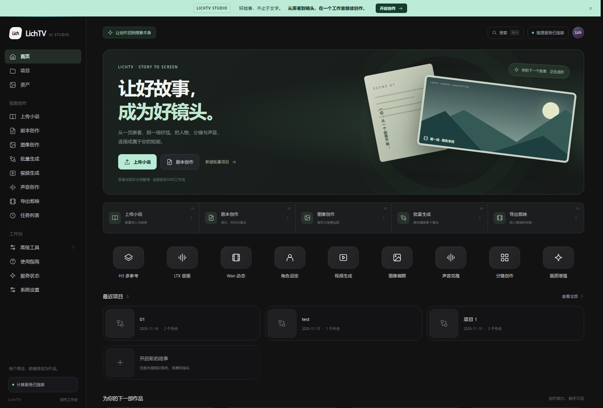

# LichTV 短剧工作室

本次按用户提供的《短剧工作室实验1.pdf》改造，保留LichTV品牌和原有5090生成服务。公网使用 `/lichtv/` 子目录；账号与积分升级见[LichTV账号、积分与视频计费](lichtv_accounts_and_credits.md)。原GPU上的工作流和数据文件保留；本站的新生成入口按账号排队计费。

## 页面与操作

| PDF要求 | 当前入口与行为 |
|---|---|
| 顶部广告宣传栏 | 全站薄荷绿色宣传栏，提供“开启创作”入口；关闭状态只保存在当前浏览器会话 |
| 上传小说与剧本分开 | “上传小说”负责原著导入、阅读、删除；“剧本创作”负责独立新建、改编草稿、编辑、保存及导出 |
| 名称改为批量生成 | 左侧“批量生成”打开账号任务队列，每行一个镜头，逐段生成和计费 |
| 生图接API和ComfyUI | “图像创作”提供两个入口；模型弹窗按本机工作流与外部API分组，支持搜索、设为默认和拉取模型 |
| 导出到剪映草稿目录 | “导出剪映”选择成片及顺序，填写本机草稿目录，生成包含视频素材和可编辑时间线的ZIP |

首页增加“上传小说 → 剧本创作 → 图像创作 → 批量生成 → 导出剪映”的五步导航。生成记录在账号的任务列表中查看，不展示虚构生成结果。桌面和手机端分别适配。



## 小说与剧本

小说支持TXT、MD、DOCX和可提取文字的PDF，单文件20MiB以内、正文200万字以内。TXT支持UTF-8和GB18030。扫描PDF不自动执行OCR；无法提取正文时会提示先识别文字。云端保存解析后的正文和文件名，不把原著自动转换成已完成的剧本。

选择原著后可“建立改编草稿”：创建场次、动作、对白、镜头建议等编辑结构，并保留前6000字原文摘录。这一步不调用大模型。“AI改编”另行使用配置好的文本API，单次原文限制3万字，较长小说应分章上传。未配置模型时先打开模型设置，不能假装已经完成AI改编。

剧本可独立保存，支持Ctrl/Cmd+S、TXT导出和分镜CSV导出。CSV按正文段落整理为待编辑镜头，并非AI自动审核后的分镜。进入批量生成后，可按行粘贴镜头描述并逐段提交。

## 图像模型与API

本机入口读取现有 `/api/workflow/list`，按图像类别列出14个工作流；实际提交到现有面板接口，沿用模板的模型、LoRA、采样和后处理。画幅与基础尺寸只覆盖已公开的对应字段。需要参考图时，通过原上传接口传到GPU实例。最终分辨率以工作流产出为准，超分可能改变尺寸。

外部API入口需要自行提供分组名称、HTTPS基础地址、密钥及实际可用的模型ID：

- 图像接口需兼容 `images/generations`，返回图片URL或base64图片。
- 文本接口需兼容 `chat/completions`。
- “拉取模型”读取对应基础地址下的 `/models`，也可手动填写模型ID。
- 模型和分组可设为默认；没有配置时展示空状态，不把参考图中的模型名称或价格当作已接入服务。

密钥存于服务端权限受限的数据文件，不在列表或设置响应中返回。外部API按供应商计费；本次没有用户提供的真实外部API密钥，因此只验证了分组保存、默认选择和密钥不回传，未声称实际调用了外部图像或文本模型。

## 剪映草稿导出

先在剪映专业版设置中确认实际“草稿位置”。网页中的目录是你的Windows本机目录，不能填写云服务器的 `/root` 或 `/data` 路径。

1. 从当前账号已有成片中选择视频，编号即时间线顺序；单次最多12段。只能导出当前账号有权访问的成片。
2. 填写草稿名称、本机草稿目录与横竖画幅。
3. 点击“生成剪映草稿包”，下载ZIP。
4. 解压，把其中的 `LichTV_<日期>_<编号>` 文件夹完整复制到填写的草稿目录，保留 `materials/`。
5. 在剪映中刷新草稿列表或重启，再打开该草稿。

草稿内的素材路径按所填Windows目录生成，时间线顺序连接所选视频，保留素材原音轨。若目录填错，应更正后重新导出。网页不会声称自己已经写入用户电脑。

生成使用[pyJianYingDraft](https://github.com/GuanYixuan/pyJianYingDraft)。当前完成了ZIP、草稿JSON、时间线、素材完整性及Windows路径验证；尚未在用户本机的剪映版本中实际打开验收，也不包含自动控制剪映导出最终MP4。

## 部署与维护

新增服务独立于GPU镜像，不改模型运行环境：

```text
浏览器 /lichtv/
  → 现有Nginx / 127.0.0.1:16028
    → 静态界面与原面板API / 16008 / AutoDL 5090
    → /studio-api/ / 127.0.0.1:16128 / 账号、积分、任务队列、文档与草稿打包
```

原本机测试入口18008通过16018提供相同工作室界面和新接口。

- 服务：`lichtv-studio.service`，仅监听回环地址16128，以www-data运行。
- 程序：`/data/lichtv-studio/app/studio_api.py`。
- 独立依赖环境：`/data/lichtv-studio/venv/`；实际安装版本保存在 `app/requirements.lock`。
- 数据：`/data/lichtv-studio/data/users/<user_id>/workspace.json`，按账号保存小说、剧本和模型设置；不要发布此文件。
- 草稿包：数据目录下 `downloads/`；API图片：`images/`。
- 前端发布与回退：保持原发布目录和current符号链接方式，切换前记录原目标；新增API路由见 `examples/deployment/zealman_gateway/liancheng-panel.conf`。

维护命令在云服务器执行：

```bash
systemctl status lichtv-studio --no-pager
curl --fail http://127.0.0.1:16128/health
journalctl -u lichtv-studio -n 30 --no-pager
```

账号升级后，首页可以免登录浏览，工作区按账号隔离；生成与下载需要登录。此前共享存储的描述仅适用于账号升级前的版本。

## 工作室初版验证记录（账号升级前）

- 六项API回归检查通过：小说和剧本独立持久化、密钥不回传、模型默认项有效性、DOCX不解压路径、真实素材草稿结构及非法导出来源拒绝。
- 真实浏览器验证小说上传、剧本保存后读取、14个工作流选择、API分组保存与删除、草稿ZIP下载、原批量画布入口和手机无横向溢出。
- 从新版生图页实际运行B18，生成并完整读取864×480图片，任务编号 `017ff85e-261d-4b0e-a2bb-900bb19354f0`。
- 使用5.167秒H3成片生成剪映草稿包，验证时间线、素材和目标Windows路径；临时小说、剧本与测试API分组已清理。

回归检查在隔离环境中执行，避免加载仓库GPU测试插件：

```bash
PYTEST_DISABLE_PLUGIN_AUTOLOAD=1 python -m pytest -c /dev/null \
  --confcutdir=examples/deployment/zealman_gateway \
  examples/deployment/zealman_gateway/test_studio_api.py -q
```
