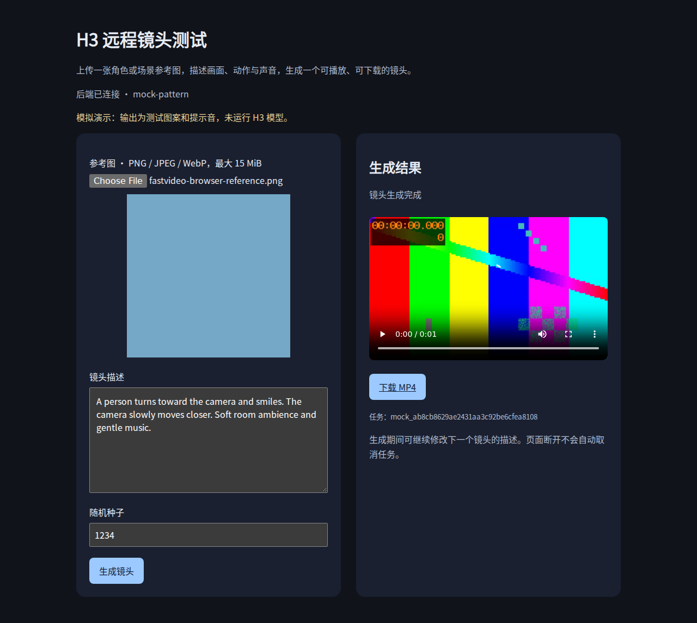

# 本地 4090 开发，AutoDL 单卡 5090 运行 H3 测试

这份指南用于验证一条完整链路：本地上传参考图 → SSH 隧道 → 5090 上的
FastH3 Omni 视频任务 API → 查询状态 → 下载并解码带音频的 MP4。

本次新增一个 CPU 可运行的测试工作台，使用当前仓库的 FastVideo 视频 API。
它是远程镜头生成的验收入口。原有 Dreamverse 实时 WebSocket 界面保持独立，
本工作台尚未实现剧本拆分镜、两项短剧制作 Skill、跨镜头角色管理和整剧合成。

## 1. 准备条件

本地需要 Linux 或 WSL、Python 3.10+、Git、OpenSSH，以及可联网安装 Python 包。
本地不需要安装 PyTorch、CUDA 或下载 H3 权重。脚本会建立独立的
`.remote5090-local/` CPU 环境，不使用你的 4090 显存。

服务器需要：

- 一张 RTX 5090 / 5090D，目标配置为 32 GB 显存。
- Linux x86_64，CUDA Toolkit 13+ 开发镜像，包含 `nvcc`、`g++`、Git、Python 和 venv。
  仅 `nvidia-smi` 显示 CUDA 13 不等于安装了 CUDA Toolkit。
- 与 CUDA 13 配套的可用 NVIDIA 驱动，以及可以访问 PyPI、GitHub 和 Hugging Face 的网络。
- SSH 密钥或 SSH agent 登录，允许本地端口转发。
- 独立的持久数据盘目录。默认 `/root/autodl-tmp/fastvideo-5090`，可通过参数更改。

主机内存和数据盘同样影响部署。首次下载、CPU 权重驻留和编译会消耗较多资源。
租用时建议优先考虑 96–128 GB 主机内存、至少 200 GB 可用数据盘作为部署预算；
这是工程预留，**不是本次实测得到的最低配置**。预检会打印主机内存、容器内存限制和可用磁盘。
不能把下述脚本存在视为单卡 GPU 验收已经通过。

推荐权重是 FastVideo 发布的
[FastH3 Omni NVFP4 QAD](https://huggingface.co/FastVideo/FastH3-Omni-NVFP4-QAD)。
它是 H3 系列的蒸馏量化版本，NVFP4 路径面向 Blackwell。
4090 使用不同的 FP8 路径，不用于本指南的 GPU 验收。

## 2. 没租服务器时，先在本地验证界面

在仓库根目录运行：

```bash
python3 apps/dreamverse/scripts/remote5090.py mock
```

安装好 CPU 依赖后，打开 `http://127.0.0.1:5299`，选择参考图并提交。
结果是有声音的测试图案，页面明确显示“模拟演示”。它可以验证上传、播放器、下载和接口，
不能验证 H3 画质、角色一致性、显存或推理速度。

按 Ctrl+C 关闭。已有 Dreamverse 占用 5299 时可指定 `--web-port 5300`。

下面是模拟模式完成上传、播放和下载后的浏览器测试截图，画面为测试图案：



## 3. 有 SSH 地址后，一条命令部署并测试

第一次连接新主机，先在终端使用 AutoDL 给出的 SSH 命令登录，核对并接受主机密钥。
确认密钥 / agent 可以登录后退出。自动脚本使用 `BatchMode=yes`，不会读取聊天中的密码，
也不会跳过主机密钥校验。

然后在本地仓库根目录运行，替换 SSH 连接信息：

```bash
python3 apps/dreamverse/scripts/remote5090.py \
  --ssh 'ssh -p 12345 root@your-autodl-host' up
```

使用指定密钥时，只传本机文件路径：

```bash
python3 apps/dreamverse/scripts/remote5090.py \
  --ssh 'ssh -p 12345 -i /home/yourname/.ssh/autodl root@your-autodl-host' \
  --reference /absolute/path/to/character.jpg up
```

默认测试参考图是仓库的 `assets/images/couple.jpg`。真实人物的外观和台词效果需要人工验收。
运行顺序如下：

1. 检查本地端口、SSH、远程 GPU、CUDA 编译器、内存和磁盘。
2. 将当前代码同步到新的 `releases/<UTC时间>/` 目录，包含本次本地修改。
   不上传 `.git`、`.env*`、常见私钥文件、模型权重和生成视频。
3. 在专用目录建立 Python 3.12 环境，安装当前 FastVideo 和 cu130 依赖。
4. 按当前仓库固定的提交拉取 CUTLASS / ThunderKittens 头文件，构建 sm_120a FP4 内核。
5. 下载完整 NVFP4 权重，生成 480p、124 帧、24 FPS、8 次 transformer 计算的服务配置。
6. 在远程 `127.0.0.1:8000` 启动模型服务，等待模型列表可用。
7. 建立本地 `127.0.0.1:18000` 到远程 8000 的 SSH 隧道。
8. 提交一次参考图生成任务，查询到完成后下载视频，并实际解码视频与音频两条流。
9. 测试成功后启动本地工作台，打开 `http://127.0.0.1:5299`。

首次运行可能需要较长时间，取决于下载速度、依赖安装和内核编译。日志持续输出；
不要因为暂时没有网页响应就重复启动。默认模型加载和单次生成的等待时间各为一小时，
可通过 `--timeout 7200` 延长。

不需要为视频服务开放公网 HTTP 端口，也不需要前端保存 SSH 凭据。
链路是浏览器 → 本机工作台 → 本机 SSH 隧道 → 服务器视频 API。

## 4. AdaLN 表和首次运行

维护中的 5090 推理配方使用预计算 AdaLN 表来节省显存。
已有**与当前权重、采样配置匹配**的表时，可以使用服务器上的路径：

```bash
python3 apps/dreamverse/scripts/remote5090.py \
  --ssh 'ssh -p 12345 root@your-autodl-host' \
  --adaln-table /root/autodl-tmp/models/adaln_table.pt up
```

没有表时，启动器显式启用代码中已有的 `FASTVIDEO_H3_ADALN_CACHE=1`：
把 AdaLN 投影保留在 CPU，按需计算并缓存调制结果。因此不要求你额外寻找表，
但会增加主机内存和首次生成开销。该自动部署组合尚需目标 5090 实机验证。
不会使用模拟输出掩盖 GPU 失败，也不会把未完成的缓存自动当作完整表加载。

模型使用发行包中的 8 层 NVFP4 视频解码器做首次验收。
确认链路稳定后，再比较 36 层质量解码器和更长片段。
完整模型原理、设备参数见 [OmniRef 推理指南](fasth3_omniref.md)。

## 5. 常用操作

仅查看部署计划，不连接服务器、不安装依赖：

```bash
python3 apps/dreamverse/scripts/remote5090.py \
  --ssh 'ssh -p 12345 root@your-autodl-host' --dry-run up
```

仅检查服务器环境，不上传代码或安装依赖：

```bash
python3 apps/dreamverse/scripts/remote5090.py \
  --ssh 'ssh -p 12345 root@your-autodl-host' doctor
```

连接已经启动的兼容 FastVideo API，不重新安装、下载或启动模型：

```bash
python3 apps/dreamverse/scripts/remote5090.py \
  --ssh 'ssh -p 12345 root@your-autodl-host' connect
```

仅执行一次真实 GPU 生成测试：

```bash
python3 apps/dreamverse/scripts/remote5090.py \
  --ssh 'ssh -p 12345 root@your-autodl-host' smoke
```

自定义端口、模型目录和数据目录：

```bash
python3 apps/dreamverse/scripts/remote5090.py \
  --ssh 'ssh -p 12345 root@your-autodl-host' \
  --remote-root /root/autodl-tmp/my-h3-test \
  --remote-port 8010 --tunnel-port 18010 --web-port 5300 \
  --model /root/autodl-tmp/models/FastH3-Omni-NVFP4-QAD up
```

模型已下载到本地目录时不再下载。HF 模型可加 `--revision <commit>` 固定版本；
默认首次下载解析当前版本，解析后的 snapshot 路径记录在 `prepared.json`。
工作台沿用服务端默认的分辨率和时长，不允许浏览器任意扩大显存开销。

`up` 默认先做一次 GPU 测试。需要先打开工作台手动测试时，可加 `--skip-smoke`，
但跳过后不能宣称 GPU 生成已通过。对已有服务使用 `connect`；重复 `up` 不会停止占用端口的进程。

## 6. 测试结果和日志在哪里

本地默认结果：

```text
outputs/remote5090/
  smoke.json             # 模型、随机种子、任务 ID、最终状态、测试是否通过
  <任务ID>.mp4           # 真实生成并下载的结果
```

成功时输出类似：

```text
5090 API ready; a successful clip is still required for GPU acceptance.
GPU test video_<id>: in_progress
GPU smoke passed: .../outputs/remote5090/video_<id>.mp4; inspect appearance, speech and continuity manually.
Workbench: http://127.0.0.1:5299 ...
```

这是期望输出示例，不是当前已完成的 5090 实测记录。

服务器默认目录：

```text
/root/autodl-tmp/fastvideo-5090/
  releases/              # 每次上传的源码快照
  venv/                  # GPU Python 环境
  hf-cache/              # 模型下载缓存
  outputs/               # 服务端生成视频
  serve-5090.yaml         # 本次解析的推理配置
  prepared.json          # 权重路径和本次启动参数
  server.log             # 模型加载及生成日志
  server.pid             # 本启动器创建的服务进程 PID
```

按 Ctrl+C 会关闭本地工作台和 SSH 隧道，**远程模型服务仍然运行并继续占用 GPU**。
重新进入用 `connect`。需要停止时，在服务器先核对 `server.pid` 对应进程的命令行，
再正常终止该服务；脚本不会自动停止服务器上的其他任务。
需要停止计费时还应在 AutoDL 控制台关闭或释放实例。

## 7. 验收标准与故障处理

通过自动测试需同时满足：模型 API 可用、生成任务完成、视频下载成功、视频和音频都可解码。
画质、人物一致性、中文台词准确度与口型仍需播放样片人工检查。

| 现象 | 处理 |
| --- | --- |
| SSH 主机密钥或认证失败 | 先手动 SSH，确认主机密钥及密钥 / agent；检查端口和用户名 |
| `nvcc` 缺失或低于 13 | 换用 CUDA 13 开发镜像，或先在服务器安装匹配工具链 |
| 本地 5299 / 18000 被占用 | 使用其他 `--web-port` / `--tunnel-port`，不必停止现有应用 |
| 远程 8000 被占用 | 已有 FastVideo 服务用 `connect`；否则选择其他 `--remote-port` |
| 权重下载报 401 / 403 | 在服务器配置自己的 HF 登录权限，或指定已准备好的 `--model` 目录 |
| 内核编译或加载失败 | 检查 `server.log` 和安装输出，确认 sm_120a、CUDA 13、驱动及编译器兼容 |
| CPU 内存不足或进程被杀 | 检查容器内存限制；考虑更大内存实例或匹配的预计算 AdaLN 表 |
| GPU OOM | 先保持默认 480p / 5 秒 / 单任务，检查其他进程占用及服务配置 |
| 提交超时、隧道断开 | POST 不会自动重试；先根据 `smoke.json` 的任务 ID 查询，避免重复计费生成 |
| 模型重启后找不到旧任务 | 现有视频 API 的任务元数据为内存记录；已下载 MP4 仍保留，持久任务恢复属于后续工作 |

工作台 API：`GET /api/status`、`POST /api/generations`、
`GET /api/generations/{id}`、`GET /api/generations/{id}/content`。
提交 JSON 为 `prompt`、`reference`（图片 data URL）、`seed`。
它们是远程生成测试接口，尚不是两项短剧制作 Skill 的业务 API。

## 8. 本地回归测试

```bash
python3 -m venv /tmp/remote5090-test
/tmp/remote5090-test/bin/python -m pip install \
  -r apps/dreamverse/remote-studio-requirements.in pytest
PYTHONPATH=apps/dreamverse /tmp/remote5090-test/bin/python -m pytest \
  apps/dreamverse/dreamverse/tests/test_remote5090.py -q
```

这些测试覆盖真实 HTTP 请求字段映射、图片校验、状态查询、分段视频下载、
网络失败不重复提交、模拟音视频解码及 SSH 参数边界，不加载 H3 权重。

完成这项验收后，下一阶段再接剧本分镜 Skill、分镜批量制作 Skill、角色素材管理和成片合成。
