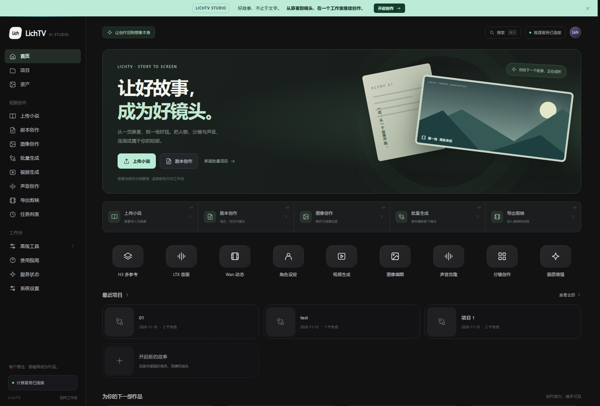

# 在云服务器部署 LichTV 制作平台

本指南配套 `examples/deployment/zealman_gateway/` 的配置模板，将制作面板作为可信团队的共享后台提供访问。域名入口为 `drama.lianchengtech.cn`，普通云服务器为 `124.174.14.4`，生成任务继续由 AutoDL 单卡5090执行。

2026年11月16日已按《短剧工作室实验1.pdf》发布工作室界面，版本 `9f82a3a13f84`。新增小说库、剧本编辑器、图像模型分组和剪映草稿打包，详见[工作室使用与维护说明](lichtv_studio_workbench.md)。公网免登录和原本机18008入口均保留。

**服务已部署，公网 `/lichtv/` 已按用户要求改为免登录访问（2026年11月15日）。** 当前可用的IP入口为 [http://124.174.14.4/lichtv/](http://124.174.14.4/lichtv/)。主域名A记录已添加并生效，入口为 [http://lianchengtech.cn/lichtv/](http://lianchengtech.cn/lichtv/)；此前公网浏览器验收成功，最新本机外网复查又观察到平台拦截，而云服务器访问仍为200，应分别判断应用与公网域名状态。主域名HTTPS尚未配置。用户此前确认域名已有ICP备案、尚未接入火山引擎，当前办理进度尚未在云控制台核验。原HTTPS子域名的 `studio` 账号和密码文件保留，不用于当前免登录子目录。私钥内容、DNS管理密码、面板密码不放入仓库。

最初部署时曾通过子域名HTTPS、未登录拦截、面板、50个工作流、H3画布、素材上传及视频下载验证；随后对子域名复查发现公网HTTP被302重定向到 `https://webblock.volcengine.com`，HTTPS握手被关闭。服务器内部面板健康接口仍为200，正式HTTPS入口本机访问返回预期的401认证挑战，服务与各域名入口的状态需要分别判断。任务链路曾用“Z-连通测试”实际提交并返回视频，该测试没有加载H3模型，后续真实生成验收见工作流测试报告。最初部署时原有两份站点配置的哈希、各业务端口响应与部署前一致。临时回环代理已移除。

## 子域名HTTPS入口复查（11月15日13:30）

该次重新登录云服务器核验了已经安装的服务。现有部署运行正常，未重新安装或替换现有业务。子域名drama的DNS记录已经正确，当时无需修改；后续新增主域名记录的结果见“公网IP子目录入口”。

| 检查项 | 2026年11月15日实测结果 |
|---|---|
| 公共DNS | Google、Cloudflare均返回 `drama.lianchengtech.cn → 124.174.14.4`，无AAAA记录 |
| 公网HTTP | `302`，服务标识 `Suzaku`，跳转至 `https://webblock.volcengine.com` |
| 公网HTTPS | TLS握手被关闭，未到达应用登录界面 |
| Nginx与GPU隧道 | 均为active；两项服务及证书续期定时器均已启用自启；`nginx -t`通过 |
| 当前前端 | `/data/liancheng-panel/releases/lichtv-v1`；页面标题 `LichTV` |
| 证书 | 域名匹配，2027年2月12日到期；云服务器内访问验证了证书信任链和主机名 |
| 未登录访问 | 首页、健康接口、样片均返回预期的401 |
| 登录后访问 | 首页、健康接口、工作流列表、H3画布和JS资源均返回200；列表包含50项 |
| 成片下载 | 经正式HTTPS虚拟主机认证后，H3样片分段下载返回206，成功读取1024字节 |
| 存储 | 系统盘剩余约67GiB，数据盘剩余约465GiB |

认证验收在云服务器内部连接127.0.0.1:443完成，保留实际域名SNI及证书校验。它证明正式站点与后端可用，**不能当作公网域名已恢复的证据**。本次未额外运行收费生成任务；此前已实测53个独立工作流，最终51项成功、2项失败，详见[完整工作流测试报告](lichtv_workflow_benchmark_2026-11-15.md)。

当前需要人工推进的是火山引擎接入备案：

1. 云账号持有人登录[火山引擎备案控制台](https://console.volcengine.com/beian/overview/)，核实主域名原备案号、备案主体以及当前接入申请状态。域名管理后台密码和服务器SSH私钥不包含该控制台权限。
2. 若尚未申请，按下文流程提交接入备案；若已申请，提供申请编号及审核状态，以便确定是否还需补资料。
3. 若已通过初审或已完成接入但仍被拦截，由云账号持有人提交工单，要求核查并解除 `drama.lianchengtech.cn` 的域名阻断，附上本表的HTTP/TLS现象和IP。根据[官方FAQ](https://docs.volcengine.com/docs/record/access-filing-faq?lang=zh)，被阻断域名提交接入备案并通过初审后，平台将尽快解除阻断；具体恢复时间以平台处理为准。

可直接交给服务器交付方的文字：

> LichTV已部署在124.174.14.4，drama.lianchengtech.cn的A记录正确，服务内HTTPS、认证、50项工作流列表和成片下载均正常。2026年11月15日公网HTTP仍被Suzaku返回302至webblock.volcengine.com，公网HTTPS握手被关闭。请核实lianchengtech.cn的火山引擎接入备案状态；需要时提交接入申请，已通过初审或已接入则请提交工单核查并解除阻断。请告知申请编号、审核状态和需我们补充的资料。

平台解除阻断后，应重新从公网验收HTTPS登录、上传、任务和文件下载。当前仍可通过下面的本机SSH隧道入口测试服务。

## 公网IP子目录入口

已将子目录版本上传至云服务器 `/data/www/lichtv/`，入口为 [http://124.174.14.4/lichtv/](http://124.174.14.4/lichtv/)。用户要求免登录后，Nginx的 `/lichtv/` 路由已改为 `auth_basic off`；IP与主域名共用该路由，首页、API、文件和WebSocket均不再要求账号。此入口为HTTP测试入口，浏览器与云服务器之间没有TLS加密；原HTTPS子域名的登录验证仍保留。匿名访问者共享同一后台，能够访问项目、素材及生成接口，生成会消耗5090算力，不具备用户隔离。

免登录变更前的路由配置已备份为 `/data/zealman-gateway/backups/lichtv-auth-20261115T105750Z.conf`。若需要恢复认证，将备份恢复到 `/etc/nginx/snippets/lichtv-ip-location.conf`，经 `nginx -t` 后重新加载Nginx；密码文件无需重建。

`/data/www/lichtv/current` 指向 `releases/` 内的发布版本。公网默认站点仅增加 `/lichtv/` 路由，未改变原首页与 `/api/` 业务；`/lichtv` 自动跳转至带尾斜杠的地址。新路由去掉前缀后转发到回环端口16028，那里提供适配后的前端，并复用16008到5090的隧道。原域名及18008本机入口继续使用原发布目录和16018。

最初公网浏览器验收已通过：首页、50项工作流列表、H3/LTX/画质增强页面、图片上传、视频Range下载（206）、WebSocket连接，以及新建画布和持久化。11月16日又完成工作室新增页面的验收，并实际运行一次B18生图。当前版本为 `/data/www/lichtv/releases/studio-20261116T082832Z`；发布前版本仍保留用于回退。当前验证与边界见工作室说明，原IP首页部署前后内容逐字节一致。

如果打开后出现“YanOPS数据平台／数据标注平台”的手机号或邮箱登录表单，那是原网站页面，不是LichTV。可用无痕窗口访问 [带版本参数的入口](http://124.174.14.4/lichtv/?v=20261115-public)，避开部署前可能保留的旧页面缓存；也可先尝试Ctrl+F5。当前免登录入口无需注册或填写账号。不要为此清除全部网站存储，以免影响原网站的本地数据。

配套文件：

- `prepare_panel_subpath.py`：复制已有定制前端，适配静态资源地址并注入浏览器路径适配器，原发布不变。
- `panel_branding/base-path.js`：将同源请求、上传、动态媒体、WebSocket和事件流限制到 `/lichtv/`，避免误调用原网站的 `/api/`；同时兼容HTTP下缺少原生randomUUID的浏览器。
- `lichtv-ip-location.conf`：放入现有IP站点server块的Nginx路由；当前按用户要求免登录，保留512MiB上传上限。

生成新版本：

```bash
python3 examples/deployment/zealman_gateway/prepare_panel_subpath.py \
  /path/to/branded-release /path/to/new-ip-release --base-path /lichtv/
```

将产物上传到 `/data/www/lichtv/releases/<新版本>/`，原子切换 `current`。新增内部站点配置为 `/etc/nginx/conf.d/lichtv-ip-panel.conf`；路径路由为 `/etc/nginx/snippets/lichtv-ip-location.conf`，由原 `/etc/nginx/sites-available/audio-annotation` 引用。首次修改前已备份至 `/data/zealman-gateway/backups/lichtv-ip-20261115T102723Z/`。回退该子目录部署时，恢复备份的原IP站点配置、移除新增内部站点配置，经 `nginx -t` 后重载；原域名站点无需回退。

DNS记录只填写IP，不填写 `/lichtv/`。已完成域名所有者短信验证，新增主域名记录 `A / @ / 124.174.14.4`，TTL为600秒，后台记录ID为6528354。已有5条记录全部保留，包括drama、mail、两条MX和一条TXT；后台现有6条记录。Google和Cloudflare均已返回正确的主域名A记录。

主域名入口为 [http://lianchengtech.cn/lichtv/](http://lianchengtech.cn/lichtv/)；添加记录后首次公网浏览器认证验收通过，首页、健康接口、50项工作流列表及H3页面均正常。取消认证后的复查中，云服务器访问该域名仍为200，本机外网访问又返回Suzaku的302阻断，不能将第一次成功解释为永久解除平台拦截或接入备案已办理完成。免登录已在应用入口生效；域名拦截仍需由平台处理。当前证书仅覆盖 `drama.lianchengtech.cn`，主域名HTTPS尚未配置。

## 当前内部测试入口

在这台开发电脑的浏览器打开 [http://127.0.0.1:18008](http://127.0.0.1:18008)。当前已建立后台SSH隧道：本机18008 → 云服务器127.0.0.1:16018定制前端 → 127.0.0.1:16008后端隧道 → AutoDL面板6008。本机入口由SSH身份认证保护，仅绑定回环地址；云服务器提供定制前端与连接转发，模型由5090执行。

已从本机Windows环境确认健康接口返回200，并通过浏览器验证50个工作流、H3画布、素材上传、Z连通任务提交、结果查询及视频下载。测试视频可访问 [http://127.0.0.1:18008/output/API-ping_00002.mp4](http://127.0.0.1:18008/output/API-ping_00002.mp4)。这次连通任务没有加载H3模型。

重启电脑或本机隧道断开后，可在这台电脑的Linux/WSL终端重新建立连接：

```bash
mkdir -p ~/.ssh
install -m 600 /mnt/c/Users/Administrator/Desktop/yeedy.pem ~/.ssh/liancheng-cloud.pem
ssh -F /dev/null -i ~/.ssh/liancheng-cloud.pem \
  -N -T \
  -o ExitOnForwardFailure=yes \
  -o ServerAliveInterval=30 \
  -o ServerAliveCountMax=3 \
  -L 127.0.0.1:18008:127.0.0.1:16018 \
  root@124.174.14.4
```

首次连接核对服务器主机指纹，连接后保持这个终端打开。若18008已被占用，先确认是否已有隧道正在运行。云服务器上的GPU隧道已配置自启；开发电脑上的本机隧道需要开发电脑保持运行。本机地址不用于其他用户的公网访问。

## 制作平台界面定制

云服务器使用独立前端发布目录 `/data/liancheng-panel/releases/`，`current` 符号链接指向当前版本。Nginx配置 `/etc/nginx/conf.d/liancheng-panel.conf` 在回环地址16018提供定制界面；API、上传和成片请求继续转发到16008。公网HTTPS配置中的上游也为16018，原有登录保护保留。

网站名称为“LichTV”，原品牌相关的中文名称统一为“Lich”。清理范围包含侧栏作者标识与群号、作者B站与网盘入口、镜像推广、关于页联系卡片、H3画布QQ群入口、API说明及导出HTML的相关名称。基础教程使用自有简明说明，旧头像与群二维码路径返回404。



当前首页按用户PDF改造，保留此前参考LibTV的深色布局和Lich自己的品牌、图标、插画，增加全站宣传栏和五步创作导航。上传小说、剧本创作分为独立页面，“H3画布”入口改名“批量生成”。九个原生创作工具、最近项目、搜索和手机导航继续保留；服务状态来自现有健康接口。

首页的项目列表读取 `/api/h3-canvas` 中的真实画布项目。“新建画布”和打开项目通过构建时添加的事件适配器调用原面板的项目管理逻辑，沿用原项目格式和保存接口；不会用演示数据替换用户项目。工具卡片跳转至已注册的视频、角色、分镜、声音与画质增强工作流。它们代表功能入口，不能作为相应模型已完成推理验收的证明。

首页布局、交互与响应式样式分别位于 `panel_branding/studio-home.js` 和 `panel_branding/studio-home.css`，原创插画位于 `panel_branding/studio-covers.svg`。原生工作流页面继续使用 `panel_branding/studio.css` 统一品牌、表单和卡片样式。原运行管理、接口文档等功能保留在侧栏的服务状态或高级工具中。

文档、图像与导出工作台位于 `panel_branding/studio-workspace.js` 和 `studio-workspace.css`；独立云端服务为 `studio_api.py`。Nginx额外将 `/studio-api/` 转到回环端口16128，GPU任务仍走原面板。

构建程序会依据内容生成发布版本，并为全部JS/CSS重命名为 `lc-<版本>-<原文件名>`，同步重写静态导入、懒加载和预加载引用。`release.json`保存对应关系，HTML中的 `application-version` 可用于核对当前版本。入口不缓存HTML并发送仅清理缓存的 `Clear-Site-Data: "cache"`，保留Cookie和本机项目存储；旧JS/CSS路径不会回退到GPU原面板。这样可避免使用原文件名时，浏览器从缓存重新显示作者标识与推广内容。

原GPU镜像的打包文件和后端保持原样。工作流ID、ComfyUI节点类名、存储键、协议常量与模型路径保持兼容；原有第三方版权/许可注释保留。镜像目录未找到面板许可证或上游仓库信息，不能据此确认用户所述开源授权及商业发布范围，正式商用前需向发行方核实。

可复用的构建程序和Nginx模板位于 `examples/deployment/zealman_gateway/`。将镜像的公开前端资源导出到含 `dist/` 的受控目录后，在本机生成新的发布目录：

```bash
python3 examples/deployment/zealman_gateway/prepare_panel_branding.py \
  /path/to/exported-panel /path/to/new-release
```

原始导出目录不变。将新发布目录上传至云服务器，切换 `current` 后强制刷新浏览器。构建器会检查导航和项目控制器的适配位置；如果上游结构改变，会停止构建并要求检查适配器。上游升级后需重新导出、生成并逐页验收；不要直接把新镜像前端覆盖到定制目录。回退可将 `current` 指向之前的定制发布目录；如需回到原始面板，将入口上游改回16008并经 `nginx -t` 后重新加载。

## 域名被平台拦截时

先确认域名是否已有ICP备案，再核对是否已在实际托管服务器的火山引擎账号下完成接入备案。域名实名认证不能代替ICP备案。根据[火山引擎接入备案说明](https://docs.volcengine.com/docs/record/access-filing-faq?lang=en)，已在其他服务商备案的域名，解析到火山引擎中国大陆服务器时仍需办理接入备案，未接入可能触发域名阻断。

若已有备案但未接入，由服务器账号持有人在火山引擎备案控制台提交接入申请；若接入已完成但仍被拦截，提交工单并附上域名、IP、HTTP跳转地址和TLS错误。不能仅凭一次公网测试成功判断平台接入已完成。备案状态以控制台和正式记录为准，不根据域名管理后台的“已实名”推断。

### 交给云账号持有人的办理说明

本次需要为已备案域名办理接入。请账号持有人登录[火山引擎备案控制台](https://console.volcengine.com/beian/overview/)，按[官方接入流程](https://docs.volcengine.com/docs/record/access-filing-process?lang=zh)完成基础信息校验，系统将识别备案类型；随后按页面要求填写原备案主体与网站信息、关联支持备案的云资源、上传资料并配合负责人核验。原备案主体须保持一致，不主动注销原接入。

资源资格也需在云控制台核实。[官方云资源要求](https://docs.volcengine.com/docs/record/preparing-to-file-cloud-resources?lang=en)包括中国大陆地区、包年包月、一次性购买3个月及以上（含续费至3个月及以上）、剩余有效期大于24小时及绑定公网IP。交付截图中的到期日期不能独立证明资源是否符合购买时长要求；先查订单与备案控制台，不据此直接续费。若使用跨账号授权，可让符合条件的云资源账号按[备案云资源FAQ](https://docs.volcengine.com/docs/record/filing-cloud-resources-faq?lang=en)提供备案授权码。

| 办理信息 | 内容 |
|---|---|
| 已备案主域名 | lianchengtech.cn |
| 当前网站入口 | drama.lianchengtech.cn |
| 公网IP | 124.174.14.4 |
| 交付实例名称 | Liancheng-1 |
| 交付实例ID | i-yet47kohs05i3z3hjbp6 |
| 公网异常 | HTTP 302至webblock.volcengine.com；HTTPS握手关闭 |
| 服务器内状态 | Nginx、GPU隧道运行；面板健康接口200；本机HTTPS认证挑战401 |
| 尚需账号持有人核实 | 原备案号、原备案主体、可用备案云资源及控制台权限 |

可直接转交以下文字给服务器交付方；本文不代为发送：

> 请协助为已备案域名 lianchengtech.cn 办理火山引擎接入备案。当前使用子域名 drama.lianchengtech.cn，解析至ECS公网IP 124.174.14.4，实例名称Liancheng-1。服务器内服务正常，公网HTTP被302跳转至webblock.volcengine.com，HTTPS握手关闭。请核实账号下资源支持备案、完成接入申请，并向平台确认解除拦截所需条件。请保留原有备案和原接入信息。

SSH私钥与域名管理密码不提供火山引擎控制台权限，不能据此直接代办接入。平台解除阻断后，再从公网复查HTTPS、登录、上传和任务接口；若仍被拦截，附上述信息提交工单。

## 日常维护

以下命令在 `124.174.14.4` 云服务器执行：

```bash
systemctl status zealman-gpu-tunnel --no-pager
curl --fail http://127.0.0.1:16008/api/health
journalctl -u zealman-gpu-tunnel -n 30 --no-pager
```

更改或追加面板登录账号使用交互输入，不在命令行传密码：

```bash
htpasswd -B /etc/nginx/drama.htpasswd studio
```

修改密码后以密码文件为准，最初交付的账号文件不会自动更新。Nginx无需重新加载即可使用新密码。账号均访问同一个管理面板，不具备独立项目或资产权限。

Nginx站点配置为 `/etc/nginx/sites-available/liancheng-drama`。隧道与 `certbot.timer` 均已启用开机自启，证书成功续期后由 `/etc/letsencrypt/renewal-hooks/deploy/liancheng-nginx-reload` 验证并重新加载Nginx。当前证书到期日为2027年2月12日。证书签发时未注册通知邮箱；日常维护需监控续期任务状态。

## 结构与边界

```text
浏览器 https://drama.lianchengtech.cn
  → 云服务器现有Nginx：TLS、整站密码验证
  → 127.0.0.1:16018：定制前端与API转发
  → 127.0.0.1:16008：systemd维护的SSH隧道
  → AutoDL 127.0.0.1:6008：Zealman面板
  → ComfyUI 6006及5090推理
```

云服务器现有网站和80/8088/8000/8010/9090业务以实际登录检查结果为准。部署增加子域名虚拟主机及默认IP站点的 `/lichtv/` 路由，保留原站点和原服务，不安装另一个抢占80/443的Web服务器。主域名解析的本次处理进度见“公网IP子目录入口”。该配置提供共享后台访问，不提供客户之间的任务、资产、管理员权限隔离。

## 1. 登录并备份现有入口配置

使用本机私钥登录，首次连接核对服务器主机指纹。若私钥存放位置权限过宽，可先复制到本机受保护目录再设为600；不要把私钥复制进项目。

```bash
ssh -i /absolute/path/yeedy.pem root@124.174.14.4
```

登录后检查 `nginx -T`、监听端口、现有证书、站点域名、磁盘和服务状态。备份Nginx配置到 `/data/zealman-gateway/backups/`。根据实际 `include` 路径选择新虚拟主机的安装目录，不能假设所有机器都使用 `sites-enabled`。

## 2. 建立GPU隧道

在云服务器创建专用系统用户 `zealman-tunnel` 及 `/data/zealman-gateway/ssh/`，生成仅用于此隧道的Ed25519密钥。目录权限700、私钥权限600，归该用户所有。

把新公钥添加到AutoDL相应SSH用户的 `authorized_keys`，保留已有条目；建议限制为只允许转发到 `127.0.0.1:6008`，禁用PTY和代理转发。使用已经核实的AutoDL主机公钥填写隧道的 `known_hosts`，不要跳过主机验证。

安装配套 `zealman-gpu-tunnel.service` 到 `/etc/systemd/system/`，再执行：

```bash
systemctl daemon-reload
systemctl enable --now zealman-gpu-tunnel.service
curl --fail http://127.0.0.1:16008/api/health
```

成功时应取得面板健康响应。隧道只绑定回环地址，公网不直接开放16008或6006。AutoDL地址或SSH端口变化时，需要更新该服务；实例关机时生成入口不可用。

## 3. 加入子域名和证书验证入口

先确认 `drama` 没有承载原有业务，再添加一条DNS记录：

| 类型 | 主机记录 | 记录值 |
|---|---|---|
| A | drama | 124.174.14.4 |

保留根域名、www、邮箱等原记录。若该子域名已有AAAA/CNAME或通配符解析，先检查是否冲突，不擅自覆盖。外网确认A记录和所有生效AAAA记录均能到达正确入口后，再申请证书。本地代理可能返回198.18.0.0/15虚拟地址，不能拿该结果作为公网DNS验证依据。

创建 `/data/zealman-gateway/acme/` 并允许Nginx读取，将 `drama-http.conf` 安装到一个新的、已被Nginx包含的配置文件。这个引导配置只开放ACME验证目录，其他请求返回503，不通过明文HTTP传递后台密码。

```bash
nginx -t
systemctl reload nginx
certbot certonly --webroot \
  -w /data/zealman-gateway/acme \
  -d drama.lianchengtech.cn
```

以上以服务器已安装Certbot为前提。采用webroot验证，保留原Nginx运行；证书联系人等参数按实际维护账号填写。申请失败时排查DNS、80端口与ACME路径，不通过停掉已有网站解决。

## 4. 设置登录验证并启用HTTPS

为团队设置独立的面板账号，不复用域名密码或SSH凭据。使用交互输入创建密码文件：

```bash
htpasswd -cB /etc/nginx/drama.htpasswd studio
```

该命令需要 `htpasswd` 工具。`-c`只用于首次创建文件，追加账号不要带 `-c`。密码文件建议640、root所有，组设置为实际Nginx工作进程用户所属组，确保Nginx可读。

用配套 `drama-https.conf` 替换本次新增的引导配置，然后执行：

```bash
nginx -t
systemctl reload nginx
```

不要同时启用两份相同 `server_name` 的引导/正式配置。正式配置含WebSocket转发、512MiB上传上限及长响应超时；可以按实际素材大小调整。将配套的 `reload-nginx-after-renewal.sh` 安装为 `/etc/letsencrypt/renewal-hooks/deploy/liancheng-nginx-reload` 并赋予执行权限，确认Certbot定时续期机制已启用。

## 5. 验收与回退

- HTTPS证书域名正确；HTTP跳转HTTPS。
- 未登录访问首页、API、WebSocket和文件路径均要求认证；正常请求预期401。
- 登录后页面静态资源、健康检查和工作流清单正常；若使用依赖WebSocket的功能，还需按该镜像实际提供的路径检查连接。
- 用“Z-连通测试”确认素材上传、提交和文件返回；该项不执行H3生成。
- 经用户选择参数提交一个短镜头，记录生成结果、音轨、耗时和显存；此前的连通测试不能代替该验证。
- 检查原有根域名、www及业务端口仍按部署前行为提供服务。

如需回退，移除或停用本次新增的子域名配置，`nginx -t`成功后重新加载；停用 `zealman-gpu-tunnel` 服务；按变更前记录恢复本次新增的DNS条目。保留原网站、业务文件、模型和Nginx主配置。

## 参考

- [Nginx WebSocket转发](https://nginx.org/en/docs/http/websocket.html)
- [Certbot webroot与续期](https://eff-certbot.readthedocs.io/en/stable/using.html)
- [AutoDL端口与自定义服务](https://api.autodl.com/docs/port/)
